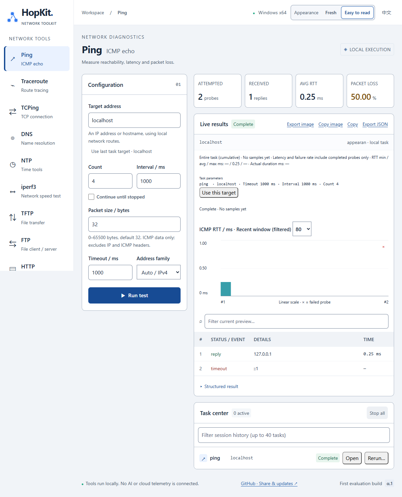

# HopKit

**Network diagnostics, file transfer, and temporary services for Windows and macOS.**

[简体中文](README.zh-CN.md) · [Downloads](https://github.com/lhuaizhong/HopKit/releases) · [User guide](docs/usage.md) · [Changelog](CHANGELOG.md) · [Issues](https://github.com/lhuaizhong/HopKit/issues)

HopKit brings network troubleshooting, continuous monitoring, throughput tests, file sharing, and log collection into one desktop app. An independent CLI shares the same Rust core for scripts and terminal use.

The feature overview covers [0.2.0-rc.1](https://github.com/lhuaizhong/HopKit/releases/tag/v0.2.0-rc.1), a testing release for Windows x64 and macOS on Apple Silicon and Intel.

## Interface preview



## Quick start

Download a package from [GitHub Releases](https://github.com/lhuaizhong/HopKit/releases). For RC.1 packages, see [the release page](https://github.com/lhuaizhong/HopKit/releases/tag/v0.2.0-rc.1) and [SHA-256 checksums](https://github.com/lhuaizhong/HopKit/releases/download/v0.2.0-rc.1/SHA256SUMS.txt).

| Platform | Package | Start |
| --- | --- | --- |
| Windows x64 | [Installer](https://github.com/lhuaizhong/HopKit/releases/download/v0.2.0-rc.1/hopkit-0.2.0-rc.1-windows-x64-setup.exe) · [ZIP](https://github.com/lhuaizhong/HopKit/releases/download/v0.2.0-rc.1/hopkit-0.2.0-rc.1-windows-x64-portable.zip) · [EXE](https://github.com/lhuaizhong/HopKit/releases/download/v0.2.0-rc.1/hopkit-0.2.0-rc.1-windows-x64-portable.exe) | Install or extract, then run `HopKit.exe` |
| macOS Apple Silicon | [DMG](https://github.com/lhuaizhong/HopKit/releases/download/v0.2.0-rc.1/hopkit-0.2.0-rc.1-macos-arm64.dmg) · [ZIP](https://github.com/lhuaizhong/HopKit/releases/download/v0.2.0-rc.1/hopkit-0.2.0-rc.1-macos-arm64.zip) · [CLI ZIP](https://github.com/lhuaizhong/HopKit/releases/download/v0.2.0-rc.1/hopkit-0.2.0-rc.1-macos-arm64-cli.zip) | Drag `HopKit.app` to Applications, or extract the ZIP |
| macOS Intel | [DMG](https://github.com/lhuaizhong/HopKit/releases/download/v0.2.0-rc.1/hopkit-0.2.0-rc.1-macos-x86_64.dmg) · [ZIP](https://github.com/lhuaizhong/HopKit/releases/download/v0.2.0-rc.1/hopkit-0.2.0-rc.1-macos-x86_64.zip) · [CLI ZIP](https://github.com/lhuaizhong/HopKit/releases/download/v0.2.0-rc.1/hopkit-0.2.0-rc.1-macos-x86_64-cli.zip) | Drag `HopKit.app` to Applications, or extract the ZIP |

Windows installers and portable ZIPs include the CLI; the standalone EXE contains only the GUI. macOS app ZIPs include the CLI, and DMGs place it in `HopKit.app/Contents/Resources/`. Separate macOS CLI ZIPs are also available.

Windows GUI requires [Microsoft Edge WebView2 Runtime](https://developer.microsoft.com/microsoft-edge/webview2/); the installer downloads it if absent. macOS uses the built-in WKWebView; see the [macOS guide](README-macOS.md). The CLI requires neither a WebView nor a development toolchain.

Windows binaries are unsigned; macOS apps use ad-hoc signing without Apple notarization. Minimum OS versions and older Windows LTSC editions still require validation.

Downloadable documentation: [English README](https://github.com/lhuaizhong/HopKit/releases/download/v0.2.0-rc.1/README.md) · [简体中文 README](https://github.com/lhuaizhong/HopKit/releases/download/v0.2.0-rc.1/README.zh-CN.md) · [macOS guide](https://github.com/lhuaizhong/HopKit/releases/download/v0.2.0-rc.1/README-macOS.md). Source packages are available on the [release page](https://github.com/lhuaizhong/HopKit/releases/tag/v0.2.0-rc.1).

## Features

### Common

| Tool | What it does | CLI command |
| --- | --- | --- |
| HopKit (Troubleshooting) | Shows local interfaces, addresses, gateways, DNS and routes. Runs staged DNS, route, ICMP, TCP and HTTP/TLS checks and suggests possible causes and next steps. | `check`, `network`, `target` |
| Ping / TCPing | Measures ICMP reachability and loss or TCP connection latency, refusals and timeouts. Each tool has optional sound alerts for successful or failed probes, with a test sound and a toggle during the test. | `ping`, `tcping` |
| Traceroute | Shows ICMP responses and timeouts along the route, hop by hop. | `trace` |
| DNS | Queries the system resolver or a specified server. Direct queries support A, AAAA, CNAME, MX, TXT, NS, PTR and SOA. | `dns` |
| iperf3 | Built-in TCP/UDP throughput client and server with live rates, reverse tests and parallel TCP streams. | `iperf3` |
| NTP | Measures clock offset, delay and stratum, or serves the local clock via temporary NTPv3/v4. | `ntp` |

### File Transfer

| Tool | What it does | CLI command |
| --- | --- | --- |
| FTP / TFTP | Uploads and downloads files, and runs temporary servers. FTP also lists remote directories. | `ftp`, `tftp` |
| HTTP File Sharing | Shares a directory for browsing and downloads in a web browser. Optional uploads support multiple files, progress and cancellation. | `http serve` |
| Wormhole | Transfers a single file with end-to-end encryption, a one-time pairing code and explicit receiver acceptance. | `wormhole send`, `wormhole receive` |

### Expert

| Tool | What it does | CLI command |
| --- | --- | --- |
| TCP Scan | Attempts TCP connections to selected ports on explicit hosts or ranges. Reports open, refused and timed-out connections, with rate limits and partial results on cancellation. | `scan tcp` |
| Discovery | Finds responsive devices using on-link IPv4 ARP, ICMP or TCP, with explicit IPv6 candidates. Shows neighbor cache and optional PTR evidence separately. Unresponsive addresses remain unknown. | `discover` |
| TCP / UDP | Connects or listens over TCP, and sends or listens over UDP. Supports UTF-8 and HEX, scheduled sends, live previews and opt-in bounded payload recording. | `socket` |
| Monitor | Tracks up to three ICMP/TCP targets on one timeline with failure and recovery periods, pause/resume, notes and before/after comparison. | `monitor` |
| Syslog | Sends and receives UDP logs with a live preview and rotating JSONL files. | `syslog` |
| MTR | Repeats IPv4/IPv6 ICMP route probes and shows target reachability, per-hop responders, RTT, jitter and changes over time. An intermediate hop can ignore probes while still forwarding traffic. | `mtr` |
| SNMP | Runs read-only SNMP v2c/v3 GET, GETNEXT, GETBULK and bounded WALK. Shows device information and IF-MIB interface rates from repeated counter samples. | `snmp` |
| Path MTU | Probes with non-fragmenting ICMP packets to establish size bounds. Explicit too-big responses can establish an upper bound. A timeout leaves the size unconfirmed. | `mtu` |
| DHCP | Reads current DHCPv4 settings and available lease details. On a selected interface, sends a bounded set of DISCOVER messages to compare received Offers with an expected server list. | `dhcp inspect`, `dhcp discover` |

### Utilities

| Tool | What it does | CLI command |
| --- | --- | --- |
| Subnet | Calculates IPv4/IPv6 CIDR ranges and exact address counts offline. Checks containment and overlap, splits prefixes and aggregates without adding uncovered addresses. | `subnet` |
| Connections | Inspects local TCP/UDP endpoints and port usage with filters and optional refresh. Shows PID and process names where the OS makes them available. | `connections` |
| Wake-on-LAN | Sends IPv4 Magic Packets to a MAC address, with broadcast suggestions based on local interface prefixes. Reports packets sent. | `wol` |

## Desktop usage

1. Open **Troubleshooting** to review interfaces, addresses, gateways, DNS, and routes.
2. Enter an IP, hostname, `host:port`, `[IPv6]:port`, or HTTP(S) URL, then start the check.
3. Choose a sidebar category or use **Find a tool** to search across all categories in either language. Click the star beside a tool to keep it in **Favorites**.
4. Copy results or export JSON. Tools with image export support **Export image / Copy image** for completed results. TCP/UDP debugging has a dedicated preview export with optional payload inclusion.

Use the header to switch between English and Simplified Chinese or between **Fresh** and **Easy to read**. The app remembers these preferences, favorites, sidebar position and supported tool settings locally. Use **Saved targets and site profiles** to name and restore common targets or parameter sets and to import or export settings as JSON. Credentials, pairing codes and message payloads are excluded from saved configurations. Loading settings leaves you at the form, ready to review and start.

Open **Task center** from any sidebar category to review up to **40 session tasks** and manage up to **4 concurrent tasks**. You can stop one task, stop all tasks or load a completed task's parameters with **Rerun…**. Task history lasts for the current session. Closing the app stops its tasks. Independent CLI processes continue running.

For browser sharing, choose **File Transfer → HTTP File Sharing**, select an existing directory, and start the service. Other devices can open the displayed address. The default port is **80**, and you can change it to **8080** or another available port. Uploads are disabled by default and never overwrite existing files.

For **Wormhole**, send one file or enter a pairing code to receive, choose a destination, and accept the transfer. Both peers must stay online. Public signaling and relay services are used by default; connection policies and privacy details are in the [user guide](docs/usage.md#wormhole).

## CLI usage

Run the CLI from the extracted package directory:

| Platform | Full entry | Short entry |
| --- | --- | --- |
| Windows PowerShell | `.\hopkit-cli.exe` | `.\shortcuts\hk.exe` |
| macOS Terminal | `./hopkit-cli` | `./shortcuts/hk` |

Examples below use `hk`; replace it with the entry above, or add `shortcuts` to PATH yourself. Replace addresses and paths with your own.

Commands with address-family selection offer **Auto / IPv4 / IPv6** in the GUI and `-4` (`--ipv4`) or `-6` (`--ipv6`) in the CLI, for example `hk ping example.com -4`. Auto selection follows the system resolver order.

```sh
hk check example.com --format json
hk ping 192.168.1.1 -c 10
hk trace example.com
hk tcping example.com 443 -c 10
hk dns example.com --system -4
hk monitor --target ping,192.168.1.1 --target tcping,example.com,443 --format jsonl
hk discover
hk scan tcp 192.0.2.10 --ports 22,443 --format json
hk mtr example.com --cycles 10 --format jsonl
hk mtu 192.0.2.10 -4 --min 576 --max 1500 --format json
hk dhcp inspect --format json
hk connections --listening --port 8080
hk subnet inspect 192.168.10.25/24
hk http serve --root ./shared --port 8080
hk --help
```

The default `text` format shows concise results and a summary. Use `--format json` for final results, `--format jsonl` for event streams, and `--lang zh-CN` for Chinese output. Stop continuous tasks with Ctrl+C. Run `hk <command> --help` for parameters or `hk doctor` to check the local environment. See the [user guide](docs/usage.md) for examples and output details.

Linux users can build the CLI from source with `cargo build --release -p hopkit-cli --locked` and run `./target/release/hopkit-cli`. IPv4/IPv6 Ping and Traceroute use kernel ICMP datagram sockets and depend on `net.ipv4.ping_group_range`. Local network overview and route queries are unavailable on Linux. RC.1 packages target Windows and macOS.

## Usage notes

- HTTP sharing, FTP, and TFTP are unencrypted. These servers default to read-only; enable uploads explicitly. Check the listening address, allowed source CIDRs, port, and firewall policy before sharing.
- HTTP/TLS diagnostics send HEAD requests and use bundled roots; they do not use system proxies or the system certificate store. Add an enterprise CA explicitly when needed.
- Path MTU supports IPv4 with DF on Windows. Windows IPv6 returns an unsupported-capability error. On macOS, IPv6 probing depends on the OS accepting source fragmentation controls. Physical path and device validation remains pending. [Path MTU details](docs/usage.md#path-mtu-source-development-m7)
- DHCPv4 discovery requires an explicit interface and exclusive access to UDP port 68. DISCOVER may temporarily reserve an Offer. HopKit leaves lease acquisition and address configuration to the system DHCP client. [DHCPv4 details](docs/usage.md#dhcpv4-diagnostics-m8)
- Connections on macOS shows endpoints and process details visible to the current user. The Linux CLI shows endpoints without PID or process attribution. [Connections details](docs/M4-开发与验收记录.md#u02-本机端口与连接)
- Charts and exported images contain the retained preview. Ping/TCPing totals cover the entire task; complete received Syslog messages are stored in log files.
- Network checks start on user action. Telemetry is disabled. There are no automatic updates, persistent task history, or installed background services.

See the [user guide](docs/usage.md) for result interpretation, exit codes, source-address behavior, and protocol/storage limits.

## Build from source

Use **Node 24** (see [`.nvmrc`](.nvmrc)) and **Rust 1.96.0** (see [`rust-toolchain.toml`](rust-toolchain.toml)). Desktop builds also require Visual Studio 2022 Build Tools on Windows or Xcode Command Line Tools on macOS. Keep both dependency lockfiles.

```sh
git clone https://github.com/lhuaizhong/HopKit.git
cd HopKit
npm ci
npm run build
cargo test --workspace --locked
cargo build -p hopkit-cli --locked
npm run desktop
```

For optimized binaries:

```sh
cargo build --release -p hopkit-cli --locked
npx tauri build --no-bundle -- --locked
```

Packaging and platform acceptance checks are described in the [release instructions](RELEASING.md) and [release workflow](.github/workflows/release.yml). Test prerequisites and evidence locations are in the [user guide](docs/usage.md#verification).

## Documentation

- [0.2.0 technical development plan (Chinese)](docs/HopKit-0.2.0-技术开发计划书.md): feature specifications, navigation, versioning, delivery order and acceptance criteria.
- [User guide](docs/usage.md): detailed examples, output, service configuration, and limits.
- [macOS guide](README-macOS.md): installation and platform-specific instructions.
- [Changelog](CHANGELOG.md) and [release instructions](RELEASING.md).

## Feedback and license

Report bugs and feature requests through [GitHub Issues](https://github.com/lhuaizhong/HopKit/issues). Include the app version, OS/architecture, steps, expected/actual results, and exported JSON. Remove sensitive addresses and log contents before sharing.

Copyright © 2026 Huaizhong Liu. HopKit-owned source uses the [MIT License](LICENSE). The bundled modified `magic-wormhole` library uses EUPL-1.2; combined distributions containing Wormhole must meet its obligations. See [distribution licensing](DISTRIBUTION_LICENSES.md) and [third-party notices](THIRD_PARTY_NOTICES.md).
