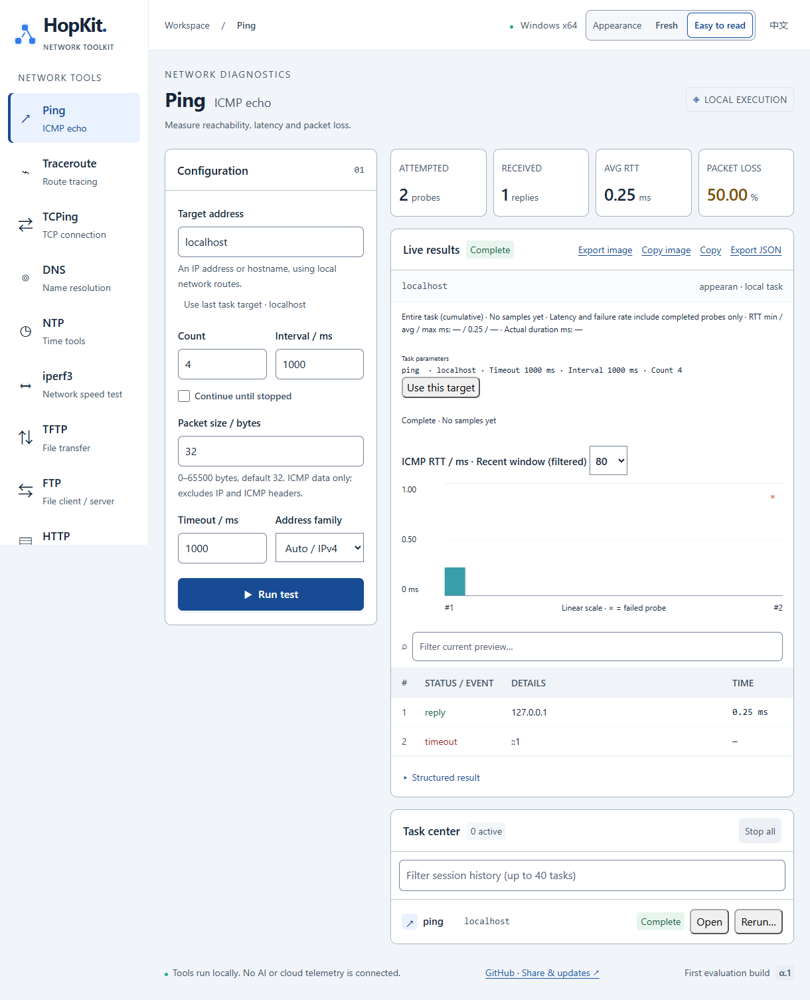

# HopKit

**Network diagnostics, file transfer, and temporary services for Windows and macOS.**

[简体中文](README.zh-CN.md) · [Downloads](https://github.com/lhuaizhong/HopKit/releases) · [User guide](docs/usage.md) · [Changelog](CHANGELOG.md) · [Issues](https://github.com/lhuaizhong/HopKit/issues)

HopKit brings network troubleshooting, continuous monitoring, throughput tests, file sharing, and log collection into one desktop app. An independent CLI shares the same Rust core for scripts and terminal use.

**Status:** release candidate `0.1.0-rc.1`. This README describes the current source tree; published packages may differ. Wormhole is implemented in source and is awaiting release acceptance. See the [implementation and validation record](WORMHOLE_IMPLEMENTATION.md).

## Interface preview



## Quick start

Download a package from [GitHub Releases](https://github.com/lhuaizhong/HopKit/releases). For the existing RC.1 packages, see [the release page](https://github.com/lhuaizhong/HopKit/releases/tag/v0.1.0-rc.1) and [SHA-256 checksums](https://github.com/lhuaizhong/HopKit/releases/download/v0.1.0-rc.1/SHA256SUMS.txt).

| Platform | Package | Start |
| --- | --- | --- |
| Windows x64 | Installer, portable ZIP, or standalone GUI EXE | Install or extract, then run `HopKit.exe` |
| macOS Apple Silicon | `macos-arm64` DMG or ZIP | Drag `HopKit.app` to Applications, or extract the ZIP |
| macOS Intel | `macos-x86_64` DMG or ZIP | Drag `HopKit.app` to Applications, or extract the ZIP |

Windows installers and portable ZIPs include the CLI; the standalone EXE contains only the GUI. macOS app ZIPs include the CLI, and DMGs place it in `HopKit.app/Contents/Resources/`. Separate macOS CLI ZIPs are also available.

Windows GUI requires [Microsoft Edge WebView2 Runtime](https://developer.microsoft.com/microsoft-edge/webview2/); the installer downloads it if absent. macOS uses the built-in WKWebView; see the [macOS guide](README-macOS.md). The CLI requires neither a WebView nor a development toolchain.

Windows binaries are unsigned; macOS apps use ad-hoc signing without Apple notarization. Minimum OS versions and older Windows LTSC editions still require validation.

## Features

| Tool | Main uses |
| --- | --- |
| Troubleshooting | Local network overview and staged DNS, route, ICMP, TCP, and HTTP/TLS checks, with possible causes and next steps |
| Monitor | Up to three ICMP/TCP targets on a common timeline; failure/recovery, pause/resume, notes, and before/after comparison |
| Ping / Traceroute / TCPing | Reachability, packet loss, hop-by-hop paths, and TCP latency |
| DNS | System or specified resolver; A, AAAA, CNAME, MX, TXT, NS, PTR, and SOA queries |
| NTP | Clock offset, delay, and stratum; temporary NTPv3/v4 server |
| iperf3 | Built-in TCP/UDP client and server, reverse download, TCP parallel streams, and live throughput |
| FTP / TFTP | File upload/download and temporary servers; FTP also supports directory listings |
| HTTP file sharing | Browse and download shared files in a browser; optional uploads |
| Wormhole | Transfer a file using a one-time pairing code and end-to-end encryption; source feature pending release |
| Syslog | UDP send/receive, live preview, and rotating JSONL logs |

The GUI supports English and Simplified Chinese, Fresh and Easy to read appearances, and JSON/PNG result export. Protocol parameters and limits are in the [user guide](docs/usage.md).

## Desktop usage

1. Open **Troubleshooting** to review interfaces, addresses, gateways, DNS, and routes.
2. Enter an IP, hostname, `host:port`, `[IPv6]:port`, or HTTP(S) URL, then start the check.
3. Review the evidence and suggested next steps. Choose a sidebar tool for a specific test, **Monitor** for continuous observation, or a file/service tool for transfers.
4. Copy results or export JSON. Completed tasks also support **Export image / Copy image** for the displayed results.

Use the header to switch language and appearance; those preferences are saved locally. The task center supports **4 concurrent tasks** and **40 session tasks**, including individual stop, stop all, and rerun. Task history and tool settings last for the current session; closing the app stops its tasks. Independent CLI processes continue running.

For browser sharing, choose **HTTP**, select an existing directory, and start the service. Other devices can open the displayed address. The default port is **80**; use another port, such as **8080**, if needed. Uploads are disabled by default and never overwrite existing files.

For **Wormhole**, send one file or enter a pairing code to receive, choose a destination, and accept the transfer. Both peers must stay online. Public signaling and relay services are used by default; connection policies and privacy details are in the [user guide](docs/usage.md#wormhole).

## CLI usage

Run the CLI from the extracted package directory:

| Platform | Full entry | Short entry |
| --- | --- | --- |
| Windows PowerShell | `.\hopkit-cli.exe` | `.\shortcuts\hk.exe` |
| macOS Terminal | `./hopkit-cli` | `./shortcuts/hk` |

Examples below use `hk`; replace it with the entry above, or add `shortcuts` to PATH yourself. Replace addresses and paths with your own.

```sh
hk check example.com --format json
hk ping 192.168.1.1 -c 10
hk trace example.com
hk tcping example.com 443 -c 10
hk dns example.com AAAA
hk monitor --target ping,192.168.1.1 --target tcping,example.com,443 --format jsonl
hk http serve --root ./shared --port 8080
hk --help
```

Use `--format json` for a final result, `--format jsonl` for event streams, and `--lang zh-CN` for Chinese result headings. Stop continuous tasks with Ctrl+C. Run `hk <command> --help` for parameters; see the [user guide](docs/usage.md) for throughput, transfer, service, and automation examples.

## Usage notes

- HTTP sharing, FTP, and TFTP are unencrypted. These servers default to read-only; enable uploads explicitly. Check the listening address, allowed source CIDRs, port, and firewall policy before sharing.
- HTTP/TLS diagnostics send HEAD requests and use bundled roots; they do not use system proxies or the system certificate store. Add an enterprise CA explicitly when needed.
- Charts and exported images contain the retained preview. Ping/TCPing totals cover the entire task; complete received Syslog messages are stored in log files.
- Network checks start on user action. Telemetry is disabled. There are no automatic updates, persistent task history, or installed background services.

See the [user guide](docs/usage.md) for result interpretation, exit codes, source-address behavior, and protocol/storage limits.

## Build from source

Use **Node 24** (see [`.nvmrc`](.nvmrc)) and **Rust 1.96.0** (see [`rust-toolchain.toml`](rust-toolchain.toml)). Desktop builds also require Visual Studio 2022 Build Tools on Windows or Xcode Command Line Tools on macOS. Keep both dependency lockfiles.

```sh
git clone https://github.com/lhuaizhong/HopKit.git
cd HopKit
npm ci
npm run build
cargo test --workspace --locked
cargo build -p hopkit-cli --locked
npm run desktop
```

For optimized binaries:

```sh
cargo build --release -p hopkit-cli --locked
npx tauri build --no-bundle -- --locked
```

Packaging and platform acceptance checks are described in the [release instructions](RELEASING.md) and [release workflow](.github/workflows/release.yml). Test prerequisites and evidence locations are in the [user guide](docs/usage.md#verification).

## Documentation

- [User guide](docs/usage.md): detailed examples, output, service configuration, and limits.
- [macOS guide](README-macOS.md): installation and platform-specific instructions.
- [Changelog](CHANGELOG.md) and [release instructions](RELEASING.md).
- [Wormhole implementation record](WORMHOLE_IMPLEMENTATION.md): validation performed and remaining release checks.

## Feedback and license

Report bugs and feature requests through [GitHub Issues](https://github.com/lhuaizhong/HopKit/issues). Include the app version, OS/architecture, steps, expected/actual results, and exported JSON. Remove sensitive addresses and log contents before sharing.

Copyright © 2026 Huaizhong Liu. HopKit-owned source uses the [MIT License](LICENSE). The bundled modified `magic-wormhole` library uses EUPL-1.2; combined distributions containing Wormhole must meet its obligations. See [distribution licensing](DISTRIBUTION_LICENSES.md) and [third-party notices](THIRD_PARTY_NOTICES.md).
