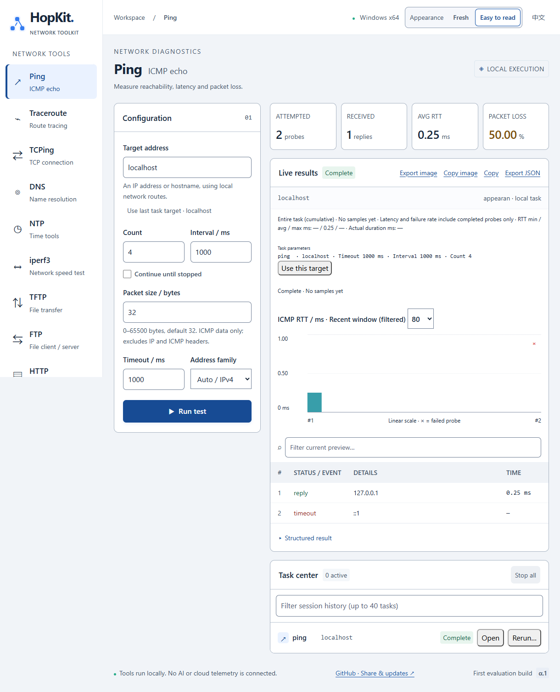

# HopKit

**面向 Windows 与 macOS 的网络诊断、文件传输与临时服务工具箱。**

[English](README.md) · [下载](https://github.com/lhuaizhong/HopKit/releases) · [使用指南](docs/usage.zh-CN.md) · [版本记录](CHANGELOG.md) · [问题反馈](https://github.com/lhuaizhong/HopKit/issues)

HopKit 将网络排障、持续监测、吞吐量测试、文件共享和日志采集集成在一个桌面应用中，同时提供独立 CLI。图形界面与命令行共享 Rust 核心，适用于日常运维和脚本自动化。

下文涵盖测试候选版 [0.2.0-rc.1](https://github.com/lhuaizhong/HopKit/releases/tag/v0.2.0-rc.1) 的功能，发布包面向 Windows x64、macOS Apple Silicon 和 macOS Intel。

## 软件界面示例



## 快速开始

前往 [GitHub Releases](https://github.com/lhuaizhong/HopKit/releases) 下载。RC.1 安装包见[发布页面](https://github.com/lhuaizhong/HopKit/releases/tag/v0.2.0-rc.1)，文件校验见 [SHA-256 清单](https://github.com/lhuaizhong/HopKit/releases/download/v0.2.0-rc.1/SHA256SUMS.txt)。

| 平台 | 安装包 | 启动方式 |
| --- | --- | --- |
| Windows x64 | [安装版](https://github.com/lhuaizhong/HopKit/releases/download/v0.2.0-rc.1/hopkit-0.2.0-rc.1-windows-x64-setup.exe) · [ZIP](https://github.com/lhuaizhong/HopKit/releases/download/v0.2.0-rc.1/hopkit-0.2.0-rc.1-windows-x64-portable.zip) · [EXE](https://github.com/lhuaizhong/HopKit/releases/download/v0.2.0-rc.1/hopkit-0.2.0-rc.1-windows-x64-portable.exe) | 安装或解压后运行 `HopKit.exe` |
| macOS Apple Silicon | [DMG](https://github.com/lhuaizhong/HopKit/releases/download/v0.2.0-rc.1/hopkit-0.2.0-rc.1-macos-arm64.dmg) · [ZIP](https://github.com/lhuaizhong/HopKit/releases/download/v0.2.0-rc.1/hopkit-0.2.0-rc.1-macos-arm64.zip) · [CLI ZIP](https://github.com/lhuaizhong/HopKit/releases/download/v0.2.0-rc.1/hopkit-0.2.0-rc.1-macos-arm64-cli.zip) | 将 `HopKit.app` 拖入 Applications，或解压 ZIP |
| macOS Intel | [DMG](https://github.com/lhuaizhong/HopKit/releases/download/v0.2.0-rc.1/hopkit-0.2.0-rc.1-macos-x86_64.dmg) · [ZIP](https://github.com/lhuaizhong/HopKit/releases/download/v0.2.0-rc.1/hopkit-0.2.0-rc.1-macos-x86_64.zip) · [CLI ZIP](https://github.com/lhuaizhong/HopKit/releases/download/v0.2.0-rc.1/hopkit-0.2.0-rc.1-macos-x86_64-cli.zip) | 将 `HopKit.app` 拖入 Applications，或解压 ZIP |

Windows 安装版和免安装 ZIP 包含 CLI，独立 EXE 仅包含 GUI。macOS 应用 ZIP 包含 CLI，DMG 内的 CLI 位于 `HopKit.app/Contents/Resources/`；另有独立 CLI ZIP。

Windows 图形界面依赖 [Microsoft Edge WebView2 Runtime](https://developer.microsoft.com/microsoft-edge/webview2/)，安装版会在缺失时下载。macOS 使用系统自带的 WKWebView，详见 [macOS 指南](README-macOS.md)。CLI 无需 WebView 或开发工具链。

Windows 程序尚未签名；macOS 使用 ad-hoc 签名，未经 Apple 公证。最低系统版本及旧版 Windows LTSC 仍需验证。

可单独下载文档：[English README](https://github.com/lhuaizhong/HopKit/releases/download/v0.2.0-rc.1/README.md) · [简体中文 README](https://github.com/lhuaizhong/HopKit/releases/download/v0.2.0-rc.1/README.zh-CN.md) · [macOS 指南](https://github.com/lhuaizhong/HopKit/releases/download/v0.2.0-rc.1/README-macOS.md)。源码包见[发布页面](https://github.com/lhuaizhong/HopKit/releases/tag/v0.2.0-rc.1)。

## 功能概览

### 常用工具

| 工具 | 主要用途 | CLI 命令 |
| --- | --- | --- |
| HopKit（网络排障） | 查看本机接口、地址、网关、DNS 和路由，分阶段检查 DNS、路由、ICMP、TCP 和 HTTP/TLS，给出可能原因与下一步建议。 | `check`、`network`、`target` |
| Ping / TCPing | 测量 ICMP 连通性与丢包，或检查 TCP 建连延迟、拒绝和超时。两者都可选择在探测成功或失败时发声，支持试听和测试中开关。 | `ping`、`tcping` |
| Traceroute（路由追踪） | 逐跳查看路由上的 ICMP 响应和超时。 | `trace` |
| DNS | 使用系统解析器或指定 DNS 服务器。直接查询支持 A、AAAA、CNAME、MX、TXT、NS、PTR 和 SOA。 | `dns` |
| iperf3 | 内置 TCP/UDP 测速客户端和服务端，支持实时速率、反向测试和 TCP 并行流。 | `iperf3` |
| NTP | 测量时钟偏差、延迟和层级，也可用本机时钟提供临时 NTPv3/v4 服务。 | `ntp` |

### 文件传输

| 工具 | 主要用途 | CLI 命令 |
| --- | --- | --- |
| FTP / TFTP | 上传、下载文件和运行临时服务。FTP 还可列出远端目录。 | `ftp`、`tftp` |
| HTTP 文件服务 | 在浏览器中浏览目录和下载文件。开启上传后，可上传多个文件并查看进度或取消。 | `http serve` |
| Wormhole | 用一次性配对码进行端到端加密的单文件传输，由接收方确认接收。 | `wormhole send`、`wormhole receive` |

### 专家工具

| 工具 | 主要用途 | CLI 命令 |
| --- | --- | --- |
| TCP Scan（TCP 端口扫描） | 对指定主机或地址范围发起 TCP 建连，区分开放、拒绝和超时，支持限速和取消后保留部分结果。 | `scan tcp` |
| Discovery（设备发现） | 通过直连 IPv4 ARP、ICMP 或 TCP 探测响应设备，IPv6 可填写明确候选地址。分别展示邻居缓存和可选的 PTR 证据，未响应地址仍为未知。 | `discover` |
| TCP / UDP（调试助手） | 支持 TCP 连接与监听、UDP 发送与监听，可收发 UTF-8 或 HEX 数据、按计划发送、实时预览，并按需限量记录报文正文。 | `socket` |
| Monitor（多目标持续监测） | 最多三个 ICMP/TCP 目标共用时间轴，记录故障与恢复，支持暂停恢复、备注和前后对比。 | `monitor` |
| Syslog | 通过 UDP 发送和接收日志，支持实时预览和 JSONL 日志轮转。 | `syslog` |
| MTR（持续路由诊断） | 持续进行 IPv4/IPv6 ICMP 逐跳探测，展示目标到达情况、各跳响应者、RTT、抖动及变化。中间跳可能继续转发流量而不回应探测。 | `mtr` |
| SNMP | 支持只读的 SNMP v2c/v3 GET、GETNEXT、GETBULK 和有界 WALK，展示设备概览，并通过 IF-MIB 计数器采样计算接口速率。 | `snmp` |
| Path MTU（路径 MTU 探测） | 使用禁止分片的 ICMP 探测确定包长边界。明确的报文过大证据可确定上界，超时的包长仍为未知。 | `mtu` |
| DHCP（配置与服务器诊断） | 只读查看当前 DHCPv4 配置和可获取的租约信息，也可在指定接口有限发送 DISCOVER，将收到的 Offer 与预期服务器清单对比。 | `dhcp inspect`、`dhcp discover` |

### 小工具

| 工具 | 主要用途 | CLI 命令 |
| --- | --- | --- |
| Subnet（子网计算器） | 离线计算 IPv4/IPv6 CIDR 范围与精确地址数，判断包含和重叠，支持前缀拆分和无空洞聚合。 | `subnet` |
| Connections（本机端口与连接） | 只读查看本机 TCP/UDP 端点与端口占用，支持筛选和定时刷新，在系统可提供时显示 PID 和进程名。 | `connections` |
| Wake-on-LAN（网络唤醒） | 按 MAC 地址发送 IPv4 Magic Packet，可根据本机接口前缀推荐广播地址，并显示发包结果。 | `wol` |

## 图形界面使用

1. 打开“网络排障”，查看本机接口、地址、网关、DNS 和路由。
2. 输入 IP、域名、`主机:端口`、`[IPv6]:端口` 或 HTTP(S) URL，开始检查。
3. 从侧栏选择分类，或用“查找工具”跨分类搜索中英文名称。点击工具旁的星标即可加入“收藏”。
4. 复制结果或导出 JSON。支持图片导出的工具可在任务完成后使用“导出图片 / 复制图片”。TCP/UDP 调试助手提供专用预览导出，可选包含报文正文。

顶部可切换简体中文和英文，以及“清新”和“视力友好”两种风格。语言、风格、收藏、侧栏位置及支持保存的工具参数会保存在本机。“收藏目标与现场配置”支持为常用目标或参数组合命名、恢复，以及通过 JSON 导入和导出。保存的配置排除凭据、配对码和报文正文。载入配置后可先核对表单，再手动启动任务。

任意侧栏分类均可打开“任务中心”，查看最多 **40 项会话任务**并管理最多 **4 个并发任务**。可停止单个任务、停止全部任务，或通过“重跑…”载入已结束任务的参数。任务历史仅在本次会话保留。退出应用会停止其任务，独立 CLI 进程继续运行。

使用浏览器共享文件时，选择“文件传输 → HTTP 文件服务”，指定已有目录并启动，其他设备即可访问界面显示的地址。默认端口为 **80**，可改为 **8080** 等可用端口。上传默认关闭，开启后也不会覆盖同名文件。

使用 **Wormhole** 时，发送方选择单个文件，接收方输入配对码、选择保存位置并确认接收。传输期间双方须保持在线。默认使用公共信令与中继服务，连接策略及隐私说明见[使用指南](docs/usage.zh-CN.md#wormhole)。

## CLI 使用

在解压后的目录中运行：

| 平台 | 完整入口 | 短入口 |
| --- | --- | --- |
| Windows PowerShell | `.\hopkit-cli.exe` | `.\shortcuts\hk.exe` |
| macOS 终端 | `./hopkit-cli` | `./shortcuts/hk` |

下文使用 `hk`，执行时请替换为上表入口，或自行将 `shortcuts` 加入 PATH。示例地址和路径需按实际环境修改。

支持选择地址族的工具可在 GUI 中选择“自动 / IPv4 / IPv6”，或在 CLI 中使用 `-4`（`--ipv4`）或 `-6`（`--ipv6`），例如 `hk ping example.com -4`。自动模式按系统解析顺序选择地址。

```sh
hk check example.com --format json
hk ping 192.168.1.1 -c 10
hk trace example.com
hk tcping example.com 443 -c 10
hk dns example.com --system -4
hk monitor --target ping,192.168.1.1 --target tcping,example.com,443 --format jsonl
hk discover
hk scan tcp 192.0.2.10 --ports 22,443 --format json
hk mtr example.com --cycles 10 --format jsonl
hk mtu 192.0.2.10 -4 --min 576 --max 1500 --format json
hk dhcp inspect --format json
hk connections --listening --port 8080
hk subnet inspect 192.168.10.25/24
hk http serve --root ./shared --port 8080
hk --help
```

默认 `text` 格式显示简洁结果和汇总。`--format json` 输出最终结果，`--format jsonl` 逐行输出事件，`--lang zh-CN` 使用中文输出。持续任务可按 Ctrl+C 停止。通过 `hk <命令> --help` 查看参数，或用 `hk doctor` 检查本机运行环境。更多示例和输出说明见[使用指南](docs/usage.zh-CN.md)。

Linux 用户可通过 `cargo build --release -p hopkit-cli --locked` 从源码构建 CLI，再运行 `./target/release/hopkit-cli`。IPv4/IPv6 Ping 和 Traceroute 使用内核 ICMP 数据报套接字，权限由 `net.ipv4.ping_group_range` 控制。Linux 暂不支持本机网络概览和路由查询。RC.1 发布包面向 Windows 和 macOS。

## 使用须知

- HTTP 文件服务、FTP 和 TFTP 均为明文传输，服务默认只读，上传须显式开启。共享前请核对监听地址、允许来源 CIDR、端口和防火墙策略。
- HTTP/TLS 排障发送 HEAD 请求并使用内置根证书，不使用系统代理或系统证书库；企业 CA 需显式添加。
- 路径 MTU 在 Windows 上支持带 DF 标志的 IPv4 探测，IPv6 会返回能力不支持。macOS 的 IPv6 探测取决于系统是否允许禁止源端分片。真实路径与设备验收仍待完成。[路径 MTU 详情](docs/usage.zh-CN.md#路径-mtum7-源码开发版)
- DHCPv4 发现须指定网卡并独占 UDP 68 端口。DISCOVER 可能让服务端临时预留 Offer 地址，租约申请与地址配置仍由系统 DHCP 客户端负责。[DHCPv4 详情](docs/usage.zh-CN.md#dhcpv4-诊断m8)
- macOS 的本机连接结果受当前用户权限限制。Linux CLI 可显示端点，暂不提供 PID 或进程归属。[本机连接详情](docs/M4-开发与验收记录.md#u02-本机端口与连接)
- 图表与导出图片只包含保留的预览；Ping/TCPing 总统计覆盖整个任务，完整收到的 Syslog 消息保存在日志文件中。
- 网络探测由用户操作触发，未启用遥测；不自动更新，不永久保存任务历史，也不安装常驻服务。

结果判读、退出码、源地址行为及协议和存储限制见[使用指南](docs/usage.zh-CN.md)。

## 从源码构建

使用 **Node 24**（见 [`.nvmrc`](.nvmrc)）和 **Rust 1.96.0**（见 [`rust-toolchain.toml`](rust-toolchain.toml)）。桌面构建另需 Windows 的 Visual Studio 2022 Build Tools，或 macOS 的 Xcode Command Line Tools。请保留两份依赖锁文件。

```sh
git clone https://github.com/lhuaizhong/HopKit.git
cd HopKit
npm ci
npm run build
cargo test --workspace --locked
cargo build -p hopkit-cli --locked
npm run desktop
```

生成优化版二进制：

```sh
cargo build --release -p hopkit-cli --locked
npx tauri build --no-bundle -- --locked
```

安装包制作和分平台验收见[发布说明](RELEASING.md)与[发布工作流](.github/workflows/release.yml)，测试前提及证据位置见[使用指南](docs/usage.zh-CN.md#验证说明)。

## 相关文档

- [0.2.0 技术开发计划书](docs/HopKit-0.2.0-技术开发计划书.md)：功能规格、导航分类、版本策略、实施顺序与验收门槛。
- [使用指南](docs/usage.zh-CN.md)：详细示例、输出格式、服务配置与限制。
- [macOS 指南](README-macOS.md)：安装及平台专用说明。
- [版本记录](CHANGELOG.md)与[发布说明](RELEASING.md)。

## 反馈与许可

请通过 [GitHub Issues](https://github.com/lhuaizhong/HopKit/issues) 提交问题与建议，附上应用版本、系统与架构、复现步骤、预期与实际结果，以及导出 JSON。分享前请移除敏感地址和日志内容。

版权所有 © 2026 Huaizhong Liu。HopKit 自有源码采用 [MIT 许可证](LICENSE)。内置的修改版 `magic-wormhole` 库采用 EUPL-1.2，包含 Wormhole 的组合分发需履行相应义务，详见[分发许可说明](DISTRIBUTION_LICENSES.md)和[第三方依赖声明](THIRD_PARTY_NOTICES.md)。
