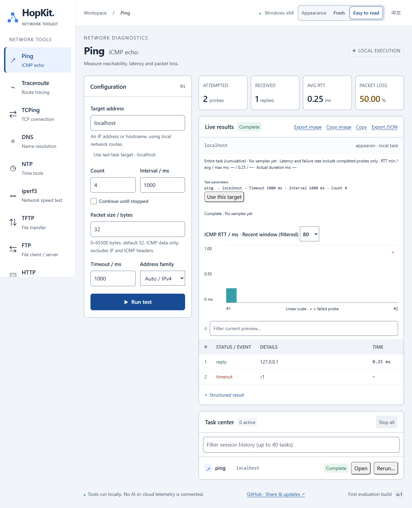

# HopKit

**面向 Windows 与 macOS 的网络诊断、文件传输与临时服务工具箱。**

[English](README.md) · [下载](https://github.com/lhuaizhong/HopKit/releases) · [使用指南](docs/usage.zh-CN.md) · [版本记录](CHANGELOG.md) · [问题反馈](https://github.com/lhuaizhong/HopKit/issues)

HopKit 将网络排障、持续监测、吞吐量测试、文件共享和日志采集集成在一个桌面应用中，同时提供独立 CLI。图形界面与命令行共享 Rust 核心，适用于日常运维和脚本自动化。

**项目状态：** 当前为候选发布版 `0.1.0-rc.2`。包含 Wormhole 加密文件传输、显式 IPv4/IPv6 选择和简洁 CLI 输出，详见[实现与验收记录](WORMHOLE_IMPLEMENTATION.md)。

## 软件界面示例



## 快速开始

前往 [GitHub Releases](https://github.com/lhuaizhong/HopKit/releases) 下载。RC.2 安装包见[发布页面](https://github.com/lhuaizhong/HopKit/releases/tag/v0.1.0-rc.2)，文件校验见 [SHA-256 清单](https://github.com/lhuaizhong/HopKit/releases/download/v0.1.0-rc.2/SHA256SUMS.txt)。

| 平台 | 安装包 | 启动方式 |
| --- | --- | --- |
| Windows x64 | [安装版](https://github.com/lhuaizhong/HopKit/releases/download/v0.1.0-rc.2/hopkit-0.1.0-rc.2-windows-x64-setup.exe) · [ZIP](https://github.com/lhuaizhong/HopKit/releases/download/v0.1.0-rc.2/hopkit-0.1.0-rc.2-windows-x64-portable.zip) · [EXE](https://github.com/lhuaizhong/HopKit/releases/download/v0.1.0-rc.2/hopkit-0.1.0-rc.2-windows-x64-portable.exe) | 安装或解压后运行 `HopKit.exe` |
| macOS Apple Silicon | [DMG](https://github.com/lhuaizhong/HopKit/releases/download/v0.1.0-rc.2/hopkit-0.1.0-rc.2-macos-arm64.dmg) · [ZIP](https://github.com/lhuaizhong/HopKit/releases/download/v0.1.0-rc.2/hopkit-0.1.0-rc.2-macos-arm64.zip) · [CLI ZIP](https://github.com/lhuaizhong/HopKit/releases/download/v0.1.0-rc.2/hopkit-0.1.0-rc.2-macos-arm64-cli.zip) | 将 `HopKit.app` 拖入 Applications，或解压 ZIP |
| macOS Intel | [DMG](https://github.com/lhuaizhong/HopKit/releases/download/v0.1.0-rc.2/hopkit-0.1.0-rc.2-macos-x86_64.dmg) · [ZIP](https://github.com/lhuaizhong/HopKit/releases/download/v0.1.0-rc.2/hopkit-0.1.0-rc.2-macos-x86_64.zip) · [CLI ZIP](https://github.com/lhuaizhong/HopKit/releases/download/v0.1.0-rc.2/hopkit-0.1.0-rc.2-macos-x86_64-cli.zip) | 将 `HopKit.app` 拖入 Applications，或解压 ZIP |

Windows 安装版和免安装 ZIP 包含 CLI，独立 EXE 仅包含 GUI。macOS 应用 ZIP 包含 CLI，DMG 内的 CLI 位于 `HopKit.app/Contents/Resources/`；另有独立 CLI ZIP。

Windows 图形界面依赖 [Microsoft Edge WebView2 Runtime](https://developer.microsoft.com/microsoft-edge/webview2/)，安装版会在缺失时下载。macOS 使用系统自带的 WKWebView，详见 [macOS 指南](README-macOS.md)。CLI 无需 WebView 或开发工具链。

Windows 程序尚未签名；macOS 使用 ad-hoc 签名，未经 Apple 公证。最低系统版本及旧版 Windows LTSC 仍需验证。

## 功能概览

| 工具 | 主要用途 |
| --- | --- |
| 网络排障 | 查看本机网络概览，分阶段检查 DNS、路由、ICMP、TCP 和 HTTP/TLS，给出可能原因与下一步建议 |
| 多目标监测 | 最多三个 ICMP/TCP 目标共用时间轴，记录故障与恢复，支持暂停、备注和前后对比 |
| Ping / Traceroute / TCPing | 检查连通性、丢包、逐跳路径与 TCP 延迟 |
| DNS | 系统解析或指定服务器，支持 A、AAAA、CNAME、MX、TXT、NS、PTR、SOA 查询 |
| NTP | 测量时钟偏差、延迟和层级，提供临时 NTPv3/v4 服务 |
| iperf3 | 内置 TCP/UDP 测速客户端与服务端，支持反向下载、TCP 并行流和实时速率 |
| FTP / TFTP | 文件上传、下载及临时服务；FTP 支持目录列表 |
| HTTP 文件服务 | 浏览器直接浏览、下载共享文件，可选开启上传 |
| Wormhole | 通过一次性配对码进行端到端加密文件传输 |
| Syslog | UDP 发送与接收、实时预览、JSONL 日志轮转 |

图形界面支持简体中文和英文、“清新”和“视力友好”两种风格，以及 JSON/PNG 结果导出。详细参数和协议限制见[使用指南](docs/usage.zh-CN.md)。

## 图形界面使用

1. 打开“网络排障”，查看本机接口、地址、网关、DNS 和路由。
2. 输入 IP、域名、`主机:端口`、`[IPv6]:端口` 或 HTTP(S) URL，开始检查。
3. 查看证据与建议；按需从侧栏选择独立工具、使用“多目标监测”持续观察，或选择文件与服务工具进行传输。
4. 复制结果或导出 JSON；任务结束后，还可通过“导出图片 / 复制图片”保存当前显示的结果。

顶部可切换语言和界面风格，偏好保存在本机。任务中心支持 **4 个并发任务**和 **40 项会话任务**，可单独停止、停止全部或重跑。历史与工具参数仅在本次会话保留，退出应用会停止其任务；独立 CLI 进程不受影响。

使用浏览器共享文件时，选择“HTTP 文件服务”，指定已有目录并启动，其他设备即可访问界面显示的地址。默认端口为 **80**，必要时可改为 **8080** 等端口。上传默认关闭，开启后也不会覆盖同名文件。

使用 **Wormhole** 时，发送方选择单个文件，接收方输入配对码、选择保存位置并确认接收。传输期间双方须保持在线。默认使用公共信令与中继服务，连接策略及隐私说明见[使用指南](docs/usage.zh-CN.md#wormhole)。

## CLI 使用

在解压后的目录中运行：

| 平台 | 完整入口 | 短入口 |
| --- | --- | --- |
| Windows PowerShell | `.\hopkit-cli.exe` | `.\shortcuts\hk.exe` |
| macOS 终端 | `./hopkit-cli` | `./shortcuts/hk` |

下文使用 `hk`，执行时请替换为上表入口，或自行将 `shortcuts` 加入 PATH。示例地址和路径需按实际环境修改。

GUI 地址类型可选“自动 / IPv4 / IPv6”；CLI 使用 `-4`（`--ipv4`）仅测试 IPv4，`-6`（`--ipv6`）仅测试 IPv6，例如 `hk ping example.com -4`。未指定时按系统解析顺序选择。

```sh
hk check example.com --format json
hk ping 192.168.1.1 -c 10
hk trace example.com
hk tcping example.com 443 -c 10
hk dns example.com --system -4
hk monitor --target ping,192.168.1.1 --target tcping,example.com,443 --format jsonl
hk http serve --root ./shared --port 8080
hk --help
```

默认 `text` 格式参照系统 `ping`，仅显示简洁结果和汇总。`--format json` 输出完整最终数据，`--format jsonl` 逐行输出事件，`--lang zh-CN` 使用中文输出。持续任务可按 Ctrl+C 停止。参数帮助使用 `hk <命令> --help`，更多示例和输出说明见[使用指南](docs/usage.zh-CN.md)。

## 使用须知

- HTTP 文件服务、FTP 和 TFTP 均为明文传输，服务默认只读，上传须显式开启。共享前请核对监听地址、允许来源 CIDR、端口和防火墙策略。
- HTTP/TLS 排障发送 HEAD 请求并使用内置根证书，不使用系统代理或系统证书库；企业 CA 需显式添加。
- 图表与导出图片只包含保留的预览；Ping/TCPing 总统计覆盖整个任务，完整收到的 Syslog 消息保存在日志文件中。
- 网络探测由用户操作触发，未启用遥测；不自动更新，不永久保存任务历史，也不安装常驻服务。

结果判读、退出码、源地址行为及协议和存储限制见[使用指南](docs/usage.zh-CN.md)。

## 从源码构建

使用 **Node 24**（见 [`.nvmrc`](.nvmrc)）和 **Rust 1.96.0**（见 [`rust-toolchain.toml`](rust-toolchain.toml)）。桌面构建另需 Windows 的 Visual Studio 2022 Build Tools，或 macOS 的 Xcode Command Line Tools。请保留两份依赖锁文件。

```sh
git clone https://github.com/lhuaizhong/HopKit.git
cd HopKit
npm ci
npm run build
cargo test --workspace --locked
cargo build -p hopkit-cli --locked
npm run desktop
```

生成优化版二进制：

```sh
cargo build --release -p hopkit-cli --locked
npx tauri build --no-bundle -- --locked
```

安装包制作和分平台验收见[发布说明](RELEASING.md)与[发布工作流](.github/workflows/release.yml)，测试前提及证据位置见[使用指南](docs/usage.zh-CN.md#验证说明)。

## 相关文档

- [使用指南](docs/usage.zh-CN.md)：详细示例、输出格式、服务配置与限制。
- [macOS 指南](README-macOS.md)：安装及平台专用说明。
- [版本记录](CHANGELOG.md)与[发布说明](RELEASING.md)。
- [Wormhole 实现记录](WORMHOLE_IMPLEMENTATION.md)：已执行验证与待完成的发布验收。

## 反馈与许可

请通过 [GitHub Issues](https://github.com/lhuaizhong/HopKit/issues) 提交问题与建议，附上应用版本、系统与架构、复现步骤、预期与实际结果，以及导出 JSON。分享前请移除敏感地址和日志内容。

版权所有 © 2026 Huaizhong Liu。HopKit 自有源码采用 [MIT 许可证](LICENSE)。内置的修改版 `magic-wormhole` 库采用 EUPL-1.2，包含 Wormhole 的组合分发需履行相应义务，详见[分发许可说明](DISTRIBUTION_LICENSES.md)和[第三方依赖声明](THIRD_PARTY_NOTICES.md)。
